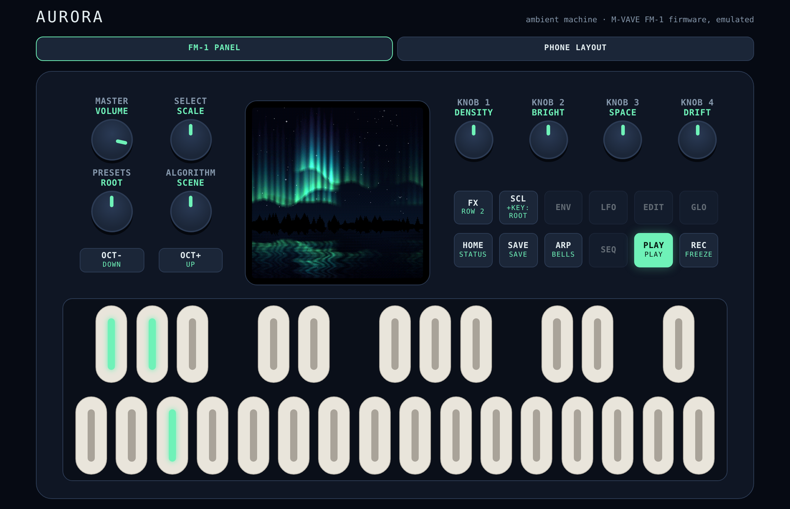

# AURORA

An ambient machine for the M-VAVE FM-1. It plays by itself: slow pads that drift through a scale over a drone, bells that fall into a long echo, and wind, all inside a very large reverb. The screen is the sky it plays under.



The same firmware runs in a browser, compiled to WebAssembly on an emulated FM-1 panel. Open `web/dist/index.html` to play it; the page is self-contained.

## Controls

| Control | What it does |
| --- | --- |
| KNOB 1–4 | DENSITY, BRIGHT, SPACE, DRIFT; with FX lit: ECHO, BELLS, WIND, DRONE |
| ALGORITHM | The scene (its sound, sky, scale and settings) |
| SELECT | The scale |
| PRESETS | The root note (or hold SCL and press a key) |
| OCT-/+ | The register |
| Keys | Play pad notes, snapped to the scale |
| PLAY | The machine plays or waits |
| REC | Freeze: the reverb holds what is in it |
| ARP | A fall of bells now |
| HOME | The first row of knobs, and what is set |
| SAVE | Keep all this as the power-on state |
| MIDI in | Notes play the pads |

In the browser: `Z`–`/`, `S`–`'` and `Q`–`0` are the keys, `←` `→` change the scene, `↑` `↓` the scale, `Space` is play, `Shift` is freeze and `Enter` is bells.

## Layout

- `firmware/src/aurora.c`: the firmware
- `shim/`: the small libc the browser build needs
- `web/`: the page and audio worklet; `web/dist/` is the built version
- `test/`: headless checks of the browser build
- `build_web.sh`: builds `web/dist/`

## Building the web version

You need clang, wasm-ld, Binaryen (`npm install binaryen`) and a checkout of [GR!MM](https://github.com/GRiMMBIENT/grimm).

```sh
GRIMM=/path/to/grimm BIN=/path/to/node_modules/.bin ./build_web.sh
```

## Credits and licence

AURORA is free software under GPL-3.0. It is built on GR!MM's platform, DSP and reverb, which stand on Felucca, Dinghy, SLOOP and X0X. The screen font is Terminus (SIL OFL 1.1). This is unofficial firmware, not made or endorsed by M-VAVE.
